---

Maeto is a SRv6-based SD-WAN platform that provides L3VPN services and routes customer traffic intelligently based on measured latency, jitter, loss and classes. It features:
- a centralized controller (`control-plane`) for computing traffic engineered paths for customers of different tiers with different SLAs and classes, 
- provider daemons (`maeto-agent`) that manage dataplane state for provider-owned routers, and 
- CPE edge daemons (`maeto-portal`) that manage tunnel states towards the provider edge. 

It's a hobby project that runs Docker containers w/ network namespaces to emulate routers through Containerlab.

See [FAQs](#faqs) for questions. If not covered, feel free to email me at [mail@saphal.me](mailto:mail@saphal.me?subject=%5BMAETO%5D%20Question%20about%20Maeto)

> [!NOTE]
> The repository on GitHub is a mirror maintained for visibility. Issue tracking and active development are done on [Forgejo](https://git.saphal.me/saphalpdyl/Maeto).

[](https://opensource.org/licenses/Apache-2.0)
[](https://git.saphal.me/saphalpdyl/Maeto/tags)

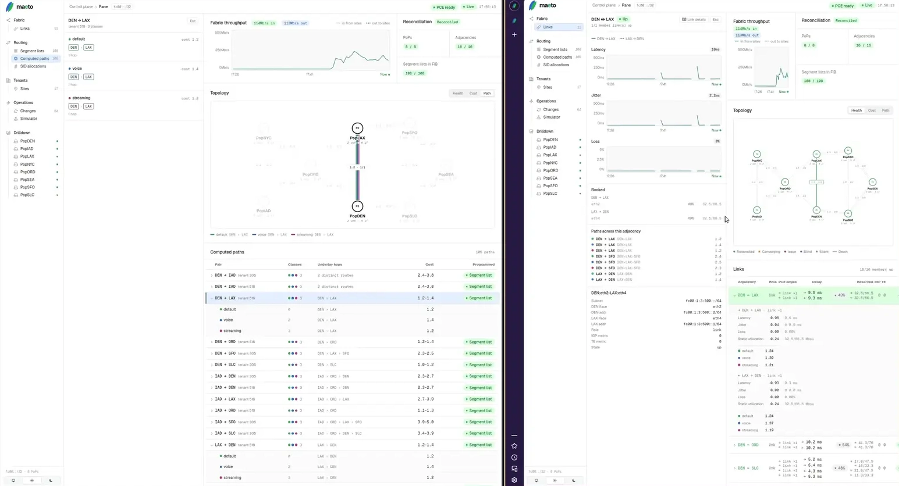
---

## Contents

- [Contents](#contents)
- [Architecture](#architecture)
  - [Controller](#controller)
    - [FRR](#frr)
  - [Provider \& CPE Agent](#provider--cpe-agent)
- [Upstreams](#upstreams)
- [Features](#features)
  - [Level-triggered reconciliation](#level-triggered-reconciliation)
  - [Bandwidth Reservation](#bandwidth-reservation)
  - [Path Computation](#path-computation)
  - [High Availability and CE dual-homing](#high-availability-and-ce-dual-homing)
  - [Active telemetry through STAMP](#active-telemetry-through-stamp)
    - [Telemetry-Key Sub-TLV](#telemetry-key-sub-tlv)
  - [BFD Link-down detection through XDP](#bfd-link-down-detection-through-xdp)
    - [WHY XDP FOR AN EMULATION ?](#why-xdp-for-an-emulation-)
  - [Traffic simulation](#traffic-simulation)
- [Running it](#running-it)
  - [Custom topology](#custom-topology)
- [Layout](#layout)
- [Writeups](#writeups)
- [FAQs](#faqs)
    - [What does emulation run on?](#what-does-emulation-run-on)
    - [Why SRv6 and not MPLS?](#why-srv6-and-not-mpls)
    - [How does path computation work?](#how-does-path-computation-work)
    - [What happens when there's no admissible path ?](#what-happens-when-theres-no-admissible-path-)
    - [What type of failures does Maeto handle ?](#what-type-of-failures-does-maeto-handle-)
    - [Where is TI-LFA ?](#where-is-ti-lfa-)
    - [Why IS-IS ?](#why-is-is-)
    - [Why not use PCEP instead of a custom level-triggered reconciler ?](#why-not-use-pcep-instead-of-a-custom-level-triggered-reconciler-)
    - [Why is there no internet breakout ? Why is topology not derived from BGP-LS but from a topology file?](#why-is-there-no-internet-breakout--why-is-topology-not-derived-from-bgp-ls-but-from-a-topology-file)
    - [Why XDP for a emulated environment?](#why-xdp-for-a-emulated-environment)
- [Status](#status)
- [Screenshots](#screenshots)
- [AI Disclosure](#ai-disclosure)

## Architecture
Distributed architecture of Maeto. The design evolved from shelling out to netlink-based communication. It intends to be compatible with a VPP backend, which is a TO-DO.

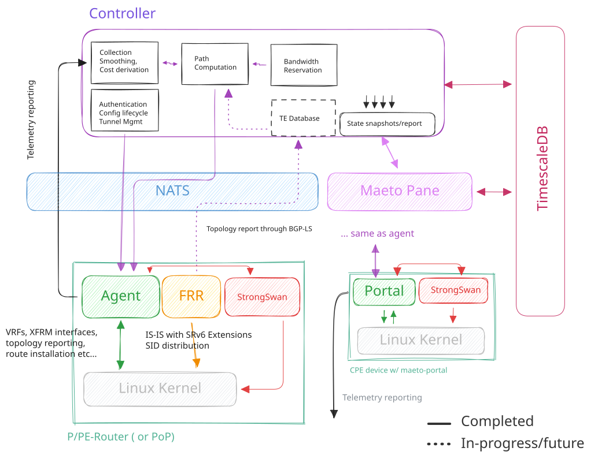

### Controller
The controller, or control plane, is the centralized brain of Maeto. It features the Path Computation Element (PCE, [RFC 5440](https://www.rfc-editor.org/info/rfc5440/)), 
tenant management, topology database, telemetry collection, tunnel management, and the cost graph for path computation. 

Although the Path Computation Element (PCE) derives the design heavily from [RFC 5440](https://www.rfc-editor.org/info/rfc5440/), 
it does implement the PCEP (protocol) itself. A few reasons:

- PCEP follows a edge-triggered reconciliation design i.e. it applies deltas/changes as they arrive. While this is simpler to make sense of, it has issues during network parition events where a delta packet being lost completely desyncs agent.
- PCEP support for FRR's `pathd` exists for SR-MPLS, but not for SRv6.

Instead, the controller heavily derives from Kubernetes-style level-triggered reconciliation. Explained [here](#level-triggered-reconciliation).

Currently, the controller supports weighted multi-cost objectives to calculate paths. Currently, latency, jitter, and observed loss are supported as objectives with bandwidth supported as the constraint.
Path computation is yet to mature. It assumes flows to be unsplittable and reroutes are bang-bang instead of drain-and-switch. It does not support constraints such as Shared Risk Link Group(SRLG), affinity, hop counts etc.

#### FRR
Maeto uses FRR's `isisd` with its SRv6 extensions, to distribute reachability info and SR locators throughout the network. 
Initially, I planned to use `pathd` to drive the dataplane installation, but I pivoted given the development was thin for SRv6 (SR-MPLS was supported).

Maeto runs [maeto-frr](https://github.com/saphalpdyl/maeto-frr), a fork of FRR master that contains my patches for `bfdd` YANG notifications.

### Provider & CPE Agent
The provider agents (`maeto-agent`) and CPE agent (`maeto-portal`) are daemons that run on Linux-based routers in Maeto. 
The daemons accept high-level intent from the controller and reconcile it against their dataplane state. Provider agents 
are equivalent to Path Computation Client (PCC) as per RFC 5440.

Portals are gateways installed in the customer premises edge. They are responsible for creating IPSec tunnels towards the 
Provider Point of Presence (PoP) of choice. They are also responsible for out-of-band device onboarding. The tunnel is driven by 
[strongSwan](https://strongswan.org/) through its VICI socket. 

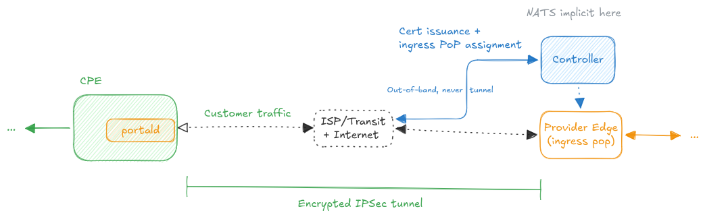

## Upstreams
Here are the collections of contributions/discussions upstream (planned, ongoing, and complete) that Maeto brought in for me:

- [in-progress] SRv6 TI-LFA Rebase [FRRouting/frr #20348](https://github.com/FRRouting/frr/pull/20348)
- [in-progress] support NFT_* shift and boolean operations in expr.Bitwise [google/nftables #375](https://github.com/google/nftables/pull/375)
- [in-progress] adds NFT_BITWISE_* {OP,DATA,SREG2} attributes... to match the kernel's support for it [golang/sys #854465](https://go-review.googlesource.com/c/sys/+/854465)
- [not-yet-submitted] FRR bfdd YANG notifications  [saphalpdyl/maeto-frr](https://github.com/saphalpdyl/maeto-frr)
- [not-yet-submitted] xdp-bfd patch for IPv6 link-local sessions [saphalpdyl/xdp-bfd](https://github.com/saphalpdyl/xdp-bfd/) | upstream: [w453y/xdp-bfd](https://github.com/w453y/xdp-bfd)
- [not-yet-submitted] FRR redistributed ipv6 table [saphalpdyl/maeto-frr commit 47d57d1](https://github.com/saphalpdyl/maeto-frr/commit/47d57d18f3d765808e1400e79956664b9c0e03f6)
- [discussion] IETF draft-ietf-rtgwg-srv6-egress-protection-26 [IETF Mail Archive- draft-ietf-rtgwg-srv6-egress-protection-26](https://mailarchive.ietf.org/arch/browse/rtgwg/?q=draft-ietf-rtgwg-srv6-egress-protection)
- [discussion] Linux Kernel End USD support for End, End.X, End.T [[PATCH net-next 0/3] seg6_local: add USP and USD flavors support (RFC 8986)](https://lore.kernel.org/netdev/20261103063806.132152-1-heminhong@kylinos.cn/)

## Features
These are a collection of the interesting features of Maeto that I gathered while developing the platform.

### Level-triggered reconciliation
Everything that touches state is level-triggered. The reconciler goes through three steps towards reconciliation.
1. **PLAN** This phase collects the desired high-level intent as well as the current dataplane state.
2. **RENDERING** The controller always send dataplane-agnostic high-level intent to the agents. It should never include details that apply to a specific dataplane. This phase is where high-level intent is "rendered" into domain-objects. Similarly, the reconciler renders dataplane state to domain-objects to compare with the desired state.
3. **DIFF** Each domain object (VRF,XFRM,Route,SRRoutes) has a `ID()` method that must be exactly discriminating as the dataplane's key for the same object fetched from it. The reconciler diffs the two rendered states and get a list of objects to remove and add. Currently, the reconciler only support `add`, `remove`, and `remove-and-add` operation. Replace and in-place edit operation require finer comparison through the `CompareTo(...)` method which exists, but is not supported.
4. **APPLY** This phase is where the dataplane state is applied. For Linux, it is done through Netlink.

### Bandwidth Reservation
Maeto supports bandwidth as a constraint i.e. the physical capacity of the link is involved in path computation. 
Naive bandwidth reservation leads to capacity being wasted due to undersubscription. Initially, Maeto implemented the pipe model for bandwidth reservation.

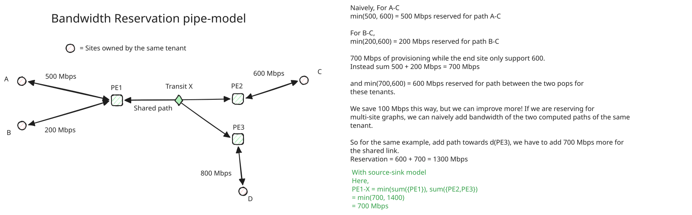

The source-sink hose model does not cause undersubscription since it allocated bandwidth for the minimum bandwidth contracted between the designated sources (one or more customer site) and designated sinks.

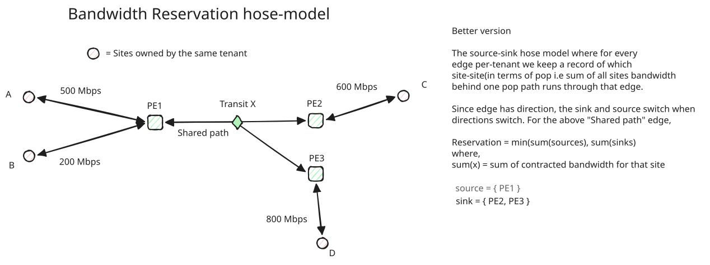

### Path Computation
The controller runs constrainted shortes path first algorithm on a pruned topology. A demand matrix is produced from different
customers, their tiers (gold, silver) and classes (voice, streaming, bulk/default). We run greedy CSPF on the graph ordering
customers by their tiers and tie-breaking on their tenant IDs to make the ordering deterministic and prevent path churn. 

Before a path of a certain color ([RFC 9256](https://datatracker.ietf.org/doc/rfc9256/)), or class, is computed for, we calculate the required bandwidth for that class of that tenant and prune
the links which do not meet the minimum bandwidth criteria. The path computation moves on as usual.

The computed path is compared with the previous path with updated costs. Reroute is forbidden with:
- **HYSTERESIS** The new path has to be at least 10% better in terms of cost than the old path. This prevents reroutes on small benefits.
- **HOLD-DOWN TIMERS** A reroute holds that path down for some time, no matter how much better the new path is. The exceptions to this are when a link in the current path goes down, or SLA is breached (future implementation).

PCE runs a weighted cost function when running CSPF where the weights come from class definition. There are four dimensions:
- `LATENCY`
- `JITTER`
- `LOSS`
- `STATIC UTILIZATION`

Collected telemetry from STAMP (see below) is smoothed through an EWMA (Exponentially Weighted Moving Average) and stored as the cost for the given link
for the given objective. Similarly, static bandwidth utilization cost is calculated after bandwidth reservation in the PCE. During path computation the costs in different units and scale are normalized and scaled using reference "considered bad"
values for each objective.

$$C(l,\sigma^2,p,u) = w_l \frac{l}{l_{ref}} + w_{\sigma^2} \frac{\sigma^2}{\sigma^2_{ref}} + w_p \frac{-\ln(1-p)}{-\ln(1-p_{ref})} + w_u \frac{\varphi(u)}{\varphi(u_{ref})} + \varepsilon$$

where,
$$u = \frac{R_e}{B_e \times (1 - h)}, \varphi(f) = \frac{f}{1-f}$$

- $R_e$ is the reserved bandwidth for the link
- $Be$ is the total capacity of the link
- $h$ is the head room fraction to leave for probes and adminstrative traffic
- $u$ is the reserved utilization of the link (not measured)
- $\varepsilon$ is the a tie-break. During path compute, it's the hop count

So with all this mathematical jargon, the total cost of the path, calculated after path computation on pruned graph, comes down to be:
$$C_c(P) = \sum_{e \in P}C_c(e)$$

As you might have noticed, I like to include LaTeX equations wherever I can.  

### High Availability and CE dual-homing
Maeto implements [draft-ietf-rtgwg-srv6-egress-protection](https://www.ietf.org/archive/id/draft-ietf-rtgwg-srv6-egress-protection-26.html) for FRR (fast reroute) on egress. Each PE is designated a protector PE that replicates its tenant RIB. Failure detected through BFD (see [BFD Link-down detection through XDP](#bfd-link-down-detection-through-xdp)) triggers a path override rule in the adjacent P routers (called Point of Local Repair, PLR).

During repair, the SRv6 packet gets encapsulated in another SRv6 packet containing pre-computed backup list (TI-LFA) towards the protector. The SRH contains the SID list towards the protector ending with the Mirror SID (End.M) which decapsulates into a VRF containing the seg6local DT.46 SIDs of the replicated PE which  again decaps into `standby-*` routing tables with routes to the CE through its backup standby link.

**NOTE**: TI-LFA ([RFC 9855](https://datatracker.ietf.org/doc/rfc9855/)) is computed on the controller in its most basic form (direct adjacency End.X SIDs to the protector). This is because FRR does not support TI-LFA for its SRv6 control plane, and Linux kernel does not support End USD for the dataplane. Works on both are being done at present. See [FAQs](#faqs) and [Upstreams](#upstreams) for more info.

With all things considered, the core (PLR) reacts within **30-50ms**, while CE switchover takes **~300ms** with deliberately configured BFD since CE-PE edge runs over the public transit which can lead to false positives, thus requiring a higher threshold. 

See me talking to myself about this: [Issue: High-availability & Dual homing](https://git.saphal.me/saphalpdyl/Maeto/issues/23)

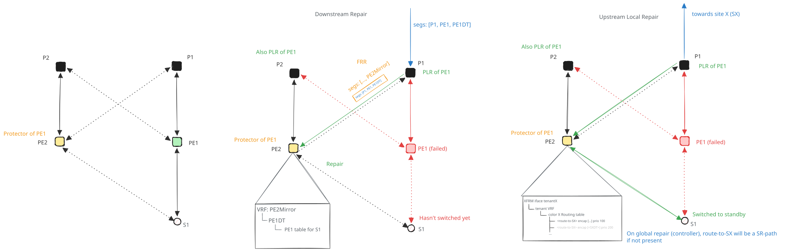


### Active telemetry through STAMP
Instead of ICMP ping, Maeto agents run unidirectional stateless Simple Two-Way Active Measurement Protocol (STAMP) sessions between two PoPs. [libs/stamp](libs/stamp) implements the [RFC 8762](https://www.rfc-editor.org/info/rfc8762/) 
with Segment Routing Extension [RFC 9503](https://www.rfc-editor.org/info/rfc9503/), and custom Maeto-specific Container TLVs to enable the unidirectional sessions itself. 

The reflector in each PoP collects the telemetry data from its peers, reads the TelemetryKey inside Maeto-Container TLV and forwards to NATS based on the key. 
The controller collects these telemetry, and regroups them based on the source. Then after, jitter and packet loss are derived from the latency and sequence number of the STAMP packet. 

```
 0                  1                  2                  3
 0 1 2 3 4 5 6 7 8 9 0 1 2 3 4 5 6 7 8 9 0 1 2 3 4 5 6 7 8 9 0 1
+-+-+-+-+-+-+-+-+-+-+-+-+-+-+-+-+-+-+-+-+-+-+-+-+-+-+-+-+-+-+-+-+
|STAMP TLV Flags|    Type=252   |             Length            |
+-+-+-+-+-+-+-+-+-+-+-+-+-+-+-+-+-+-+-+-+-+-+-+-+-+-+-+-+-+-+-+-+
:                        Maeto Container                        :
+-+-+-+-+-+-+-+-+-+-+-+-+-+-+-+-+-+-+-+-+-+-+-+-+-+-+-+-+-+-+-+-+
```

#### Telemetry-Key Sub-TLV
```
 0                  1                  2                  3
 0 1 2 3 4 5 6 7 8 9 0 1 2 3 4 5 6 7 8 9 0 1 2 3 4 5 6 7 8 9 0 1
+-+-+-+-+-+-+-+-+-+-+-+-+-+-+-+-+-+-+-+-+-+-+-+-+-+-+-+-+-+-+-+-+
|STAMP TLV Flags|     Type=1    |             Length            |
+-+-+-+-+-+-+-+-+-+-+-+-+-+-+-+-+-+-+-+-+-+-+-+-+-+-+-+-+-+-+-+-+
:                         Telemetry-Key                         :
+-+-+-+-+-+-+-+-+-+-+-+-+-+-+-+-+-+-+-+-+-+-+-+-+-+-+-+-+-+-+-+-+
```

### BFD Link-down detection through XDP
Bidirectional Forwarding Detection [[RFC 5880](https://www.rfc-editor.org/info/rfc5880/)] is a protocol intended to detect faults in the bidirectional path between two forwarding engines. Maeto uses BFD through FRR's `bffd` with dataplane offload to XDP through a fork of [xdp-bfd](https://github.com/w453y/xdp-bfd). Maeto also has its own fork of FRR called `maeto-frr` with a patched `bffd` to allow FRR modules to receive BFD notification through FRR's YANG northbound and relay it to external application. 

`frr-modules/` contains `Maeto` FRR plugin/module that starts up with `bffd` which is the relay to `maeto-agent`. The messages are exchanged with IPC using unix sockets.

#### WHY XDP FOR AN EMULATION ?
See [FAQs](#faqs).

### Traffic simulation
`clab/tfsim` and `maeto-sim` are the traffic simulation components of Maeto that generate something similar to realistic customer traffic. They make use `iperf3` sessions to emulate data transfer. The transfer sizers are log-normal (Pareto), and so are the call-lengths (voice sessions). This makes it so that most of the traffic is small transfer size (DNS query, web search etc), while a few of them are big long-running elephant flows (backup, OS updates, whatever bulky).

`tfsim` is the core of traffic simulation. It parses scenarios (.yml files), and drives the sessions. `maeto-sim` builds an application layer on top of it. For the demo, all simulation are restricted to a max time and max faults at once (2). For an actual endless loop locally, you can run:

```
make tfsim-random
```

*While the scenario DSL and general design was designed by me, tfsim and maeto-sim are AI-generated. Controller and dataplane are more fun to mess around with.*

## Running it
VM-based local deployment requires [Vagrant](https://developer.hashicorp.com/vagrant) to be installed with the `libvirt` provider. Highly recommend running inside a VM due to strict dependencies and to prevent stale network namespaces/configuration ending up on the host.

```sh
vagrant up # Highly recommended to run in VMs
vagrant ssh

# Run sequentially
make setup   # venvs + git hooks
make pki     # one-time CA, the generator signs PoP and CPE certs off it
make ap      # generate the topology, build the images, deploy the lab
# IMPORTANT: Wait for ap to complete fully (takes a good chunk of time on first build largely due to FRR build)

# Run in parallel
make dev     # start the controller
make fe      # maeto-pane
make sim     # maeto-sim, the pane's Simulator page

make clean   # to destroy the lab

# Optional
make dozzle  # for container logs (will later be replaced by Grafana stack)
make nui     # to view NATS state
make ips     # lists ipv6 addresses of interface of each node
```

### Custom topology
Topologies can be defined in `clab/topologies/**` as a `.yml` file. 

```yaml
name: <your-lab-name>

defaults:
  # The generator deterministically generates IPv6 address from these prefixes
  locator_prefix: <node-locator-prefix>
  link_prefix: <interface-prefix>
  edge_prefix: <edge-prefix> # A stand-in for the "internet" in-between customers and the access edge

classes:
  <class-name>: # For eg. voice
    label: 2 # identifier [MUST be unique] RFC 9256 equivalent
    index: 1 # Greater the value, the more priority it has during path computation
    match: { dscp: [...] } # Maeto will match these dscps for this class to <label> when computing paths
    objective: # Weights to count towards the total cost, see [Active telemetry through STAMP]
      latency: x
      jitter: y
      loss: z
  # ... more classes

tiers:
  <tier-name>:
    # index == 0, is always designated as the default/bulk traffic
    index: 2 # Greater the value, the more priority it has during path computation
    # The remaining bandwidth is always assigned to default/bulk
    classes: { <class-name>: <fraction-of-total-bandwidth-assigned> } # For eg. voice: 0.3, streaming: 0.2

tenants:
  - id: xxx # numeric customer identifier
    allocation: <customer-prefix> # Currently only one prefix is supported
    tier: <tier-name>
  # ...

# Topology
pops: # Provider owned edge/transit routers
  - id: <pop-name> # For eg. NYC
    index: 1 # Unique numeric identifier
  # ...

cpes: # This defines customer sites
  - id: cABC # Unique string identifier
    tenant: xxx # id of the tenant this site belongs to
    # We only support a site connecting to one assigned PoP
    # Dynamic access edge selection is future work
    attach: <pop-id>
    prefix: <site-prefix> # Must sit inside the tenant's allocation
    portal_id: <unique-string-id> # Comparable to LDevID [802.1AR: Secure Device Identity]
    reservation_bandwidth: xxx # Total in-out bandwidth contracted for the site in Mbps
    classes: { <class-name>: <Mbps> } # Optional, replaces the tier's split for this site
  # ...

links:
  - a: <pop-id>
    b: <pop-id>
    parallel:
      - bandwidth: <total-capacity-of-link-Mbps>
        delay: xx # Propagation delay in ms
        start_jitter: xx # Jitters propagation delay by start_jitter(ms) during generation
      # ...
  # ...
```

## Layout
```
libs/stamp              RFC 8762 sender and reflector, wire codec, SRv6 TLVs
libs/dataplane          netlink -- vrfs, seg6/seg6local, xfrm, declarative reconciler
libs/probe              probe supervisor, STAMP runners, NATS dispatch
libs/nodesync           intent and snapshot contracts over NATS KV
services/control-plane  topology, intent, cost graph, PCE
services/maeto-agent    runs on each PoP, reconciles intent onto the kernel
services/maeto-portal   runs on each CPE
services/maeto-pane     phoenix liveview ui
clab/generator          topology dsl -> containerlab, frr, addressing, link shaping
clab/tfsim              customer-like traffic: random sessions or fixed scenarios over iperf3
services/maeto-sim      fault injection (netem, link down), stories and tfsim runs for the pane
```

## Writeups
Things I hit along the way, mostly SRv6 and FRR: [blogs.saphal.me/tags/maeto](https://blogs.saphal.me/tags/maeto/)

## FAQs
#### What does emulation run on?
It's [Containerlab](https://containerlab.dev/). Each node is a container with its own network namespace. All nodes do share the same kernel though, since in the end they are containers.

#### Why SRv6 and not MPLS?
I started Segment Routing over IPv6 (SRv6) because an SID is just a routable IPv6 address. MPLS labels mean nothing by themselves; so it requires a separate transport protocol and the core has to be MPLS compatible. Only routers that act on the SID has to talk SRv6.  Furthermore, it lets me runs best-effort traffic with IGP i.e the SID stack can just be `[<VPN SID>]` and it would reach the egress PE.

Maeto uses this for:

- best-effort traffic for tenants before paths are calculated.
- best-effort traffic for tenants who had their path admission rejected.
- best-effort traffic for a protector which does not have a site of the tenants of the protected PE.

I am aware of the MTU cost that 40-byte SRv6 encapsulation + 16 bytes per SID brings, in contrast to MPLS' 4-byte label.  SID compression with NEXT-CSID and H.Encaps.Red behaviors are in the 'After demo' TODO.

#### How does path computation work?
Path computation assumes unsplittable flows with bang-bang (all-at-once) reroutes.  Maeto's controller computes path heuristically (greedy) by building tenant demands in a deterministic order by priority and traffic class. 

Unsplittable multi-commodity flows are NP-hard. Future improvements would include making flows splittable and reroute as a drain-and-switch to allow for better oscillation prevention. Path computation inspires heavily from [Google's B4 architecture ](https://dl.acm.org/doi/10.1145/2534169.2486019).

#### What happens when there's no admissible path ?
It falls back to best-effort IGP-driven traffic. Ideally, it should be marked low priority in qdisc, but that is not implemented yet.

#### What type of failures does Maeto handle ?
Maeto protects against both transit and egress failures. The reaction time is a bit differnet. Reroute for egress-down events are repaired locally using precomputed backup stacks, breaking SLAs. The controller later reconverges to a SLA-compliant configuration. 

Transit segments are controller-repaired. Unlike, egress protection, they have no local repair since FRR and the kernel both are missing support required for TI-LFA transit repair.

Now technically, transit failures are protected for specific links such as the P-PE links where the P acts as the PLR and reroutes towards the protector (because it uses its own local view of adjancency status to derive node down status).

#### Where is TI-LFA ? 
It is defined in `services/control-plane/controller_lfa.go` and `services/control-plane/pce_lfa.go`. As stated, the repair are precomputed in the controller since SRv6 TI-LFA support for FRR is an ongoing-PR. It also implements the most basic form of TI-LFA ([RFC 9855 § 3](https://www.rfc-editor.org/info/rfc9855/#section-3)) 

#### Why IS-IS ? 
Support for SRv6 has been more prevalent on IS-IS due to its extensibility through TLVs. FRR supported SRv6 primarily on IS-IS and examples/presentation on SRv6 assumed an IS-IS underlay. I am aware of OSPFv3 SRv6 extensions [RFC 9513](https://datatracker.ietf.org/doc/rfc9513/), but implementation and support is thin.

#### Why not use PCEP instead of a custom level-triggered reconciler ?
I initially designed the system with PCEP in mind. Later, I found out that `pathd` in FRR has thin support for PCEP on SRv6. Furthermore, edge-triggered reconciliation on a system expected to have network partition seemed like grounds for nasty desync bugs. Periodically sending the full snapshot like PCEP does would have made the desync bugs transient, but I just did not like it.

So, I went with level-triggered reconciliation with tradeoff of larger intents being sent to the nodes.

#### Why is there no internet breakout ? Why is topology not derived from BGP-LS but from a topology file? 
Simplicity. Less things to worry about when I started.

#### Why XDP for a emulated environment?
Maeto runs in a VM, and its demo will run in a resource-constrained Hetzner box. Under load, userspace BFD will miss deadlines and create false-positives. XDP keeps BFD's timer independent of userspace scheduling.

## Status
Done/In-progress:
- SRv6 dataplane over Netlink. VRFs, xfrm interfaces, seg6/seg6local SIDs and ip rules, reconciled against a desired state
- IS-IS + SRv6 fabric, generated from one topology file along with addressing, FRR config and link shaping
- Intent distributed to agents over NATS KV
- IKEv2/X.509 tunnels out to the CPEs
- Per-link one-way STAMP probing (RFC 8762). The reflector exports its own receive timestamps instead of reflecting
- Latency cost graph fed from the probes. PCE recomputes every tick, 10% gate before it will actually move a path
- maeto-pane: topology, per-link cost, and path changes with the edge whose cost caused them
- Bandwidth-aware hose-modeled path computation
- Passive telemetry collection
- Loss and jitter are NOT seeded values anymore. 
- Provider Edge rate limiting (policing)
- BFD-based link-down interface-up events
- Dual-homing and sub-100ms FRR inside the core and failure recovery

Not yet:
- Netlink-based link-down interface-down events
- BGP-LS defined topology instead of statically generated topology
- Link and Node Utilization in Cost  Graph as logical links.
- Flexible Bandwidth Reservation: CIR, PIR and best-effort traffic allocation
- Hybrid: Fast greedy + Slow LP optimization with hold-down timer and partially moving traffic with observations as confirmation
- Cost impact prediction before moving paths
- Flowlet switching for elephant flows w/ eBPF for flow detection and switching itself.

## Screenshots 
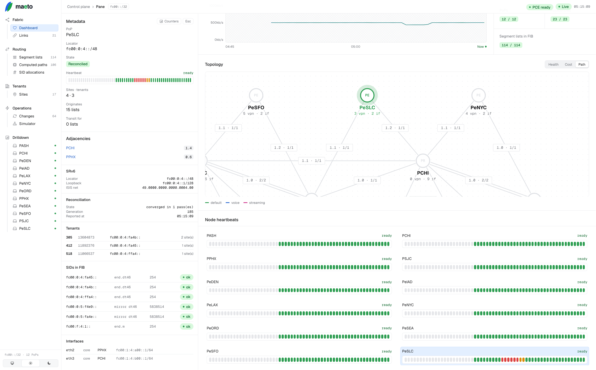

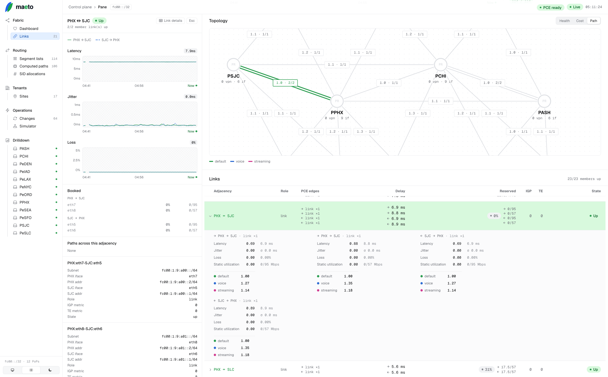

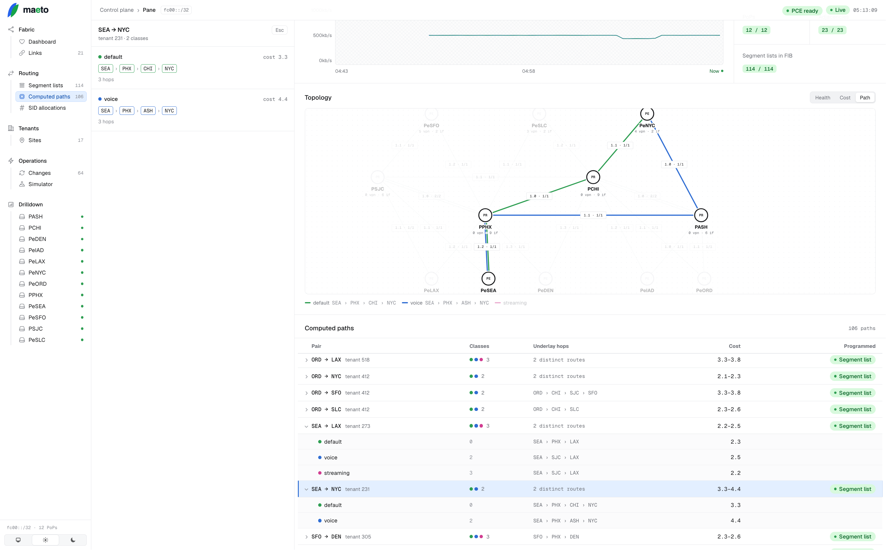

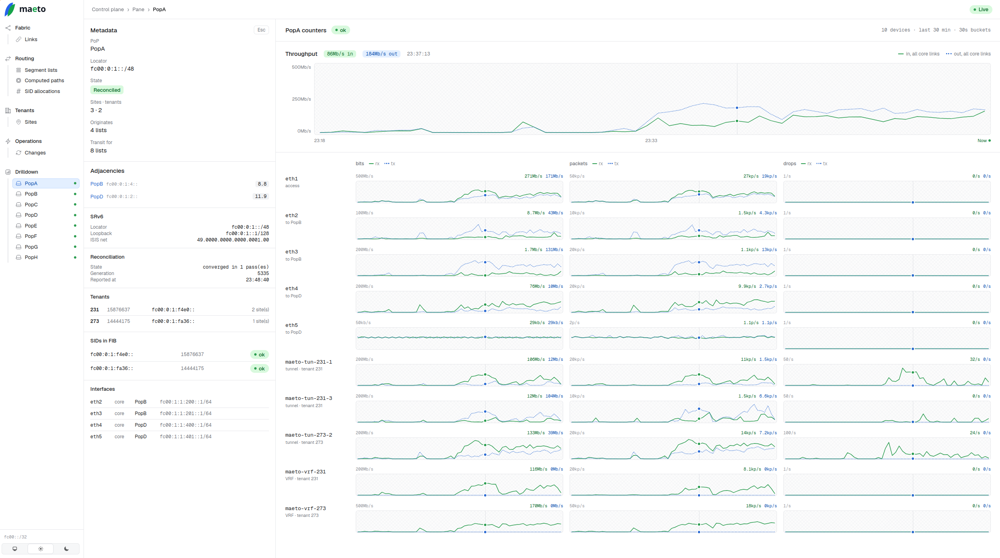

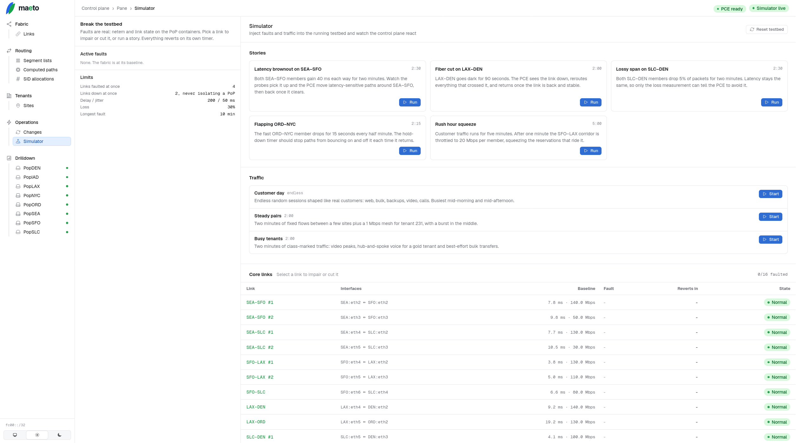

---
 by saphalpdyl


## AI Disclosure
Maeto is AI-assisted on peripheral components such as the topology generator, traffic simulator, frontend and DB-related/CRUD
operations in the control-plane. Almost everything in control-plane is written by me excepting for state snapshotting
(for the frontend's use). Likewise, maeto-agent, maeto-portal and libs/ are written by hand.

I use AI assistance where what I'm building isn't focused on the core problem (building an SD-WAN in this case). 
