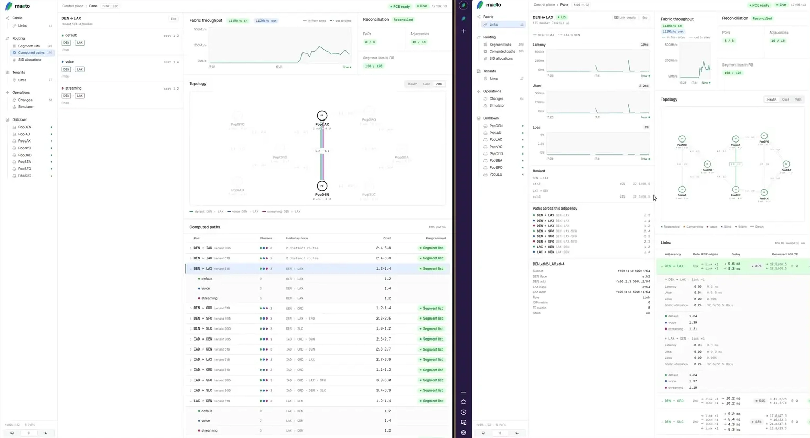
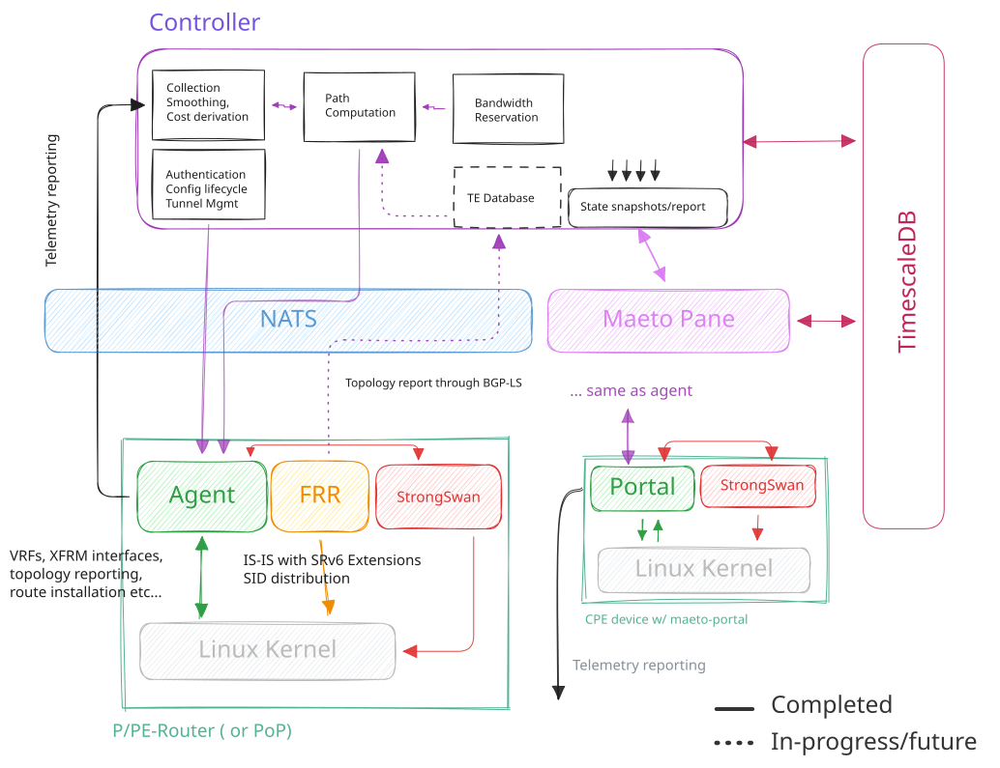
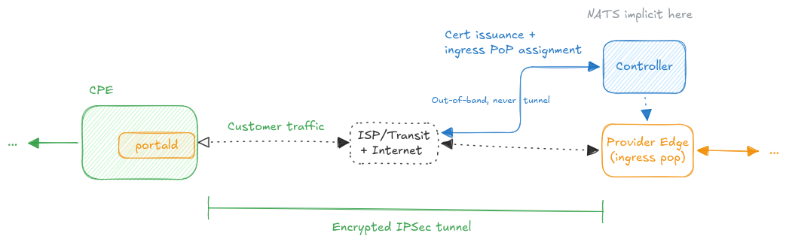
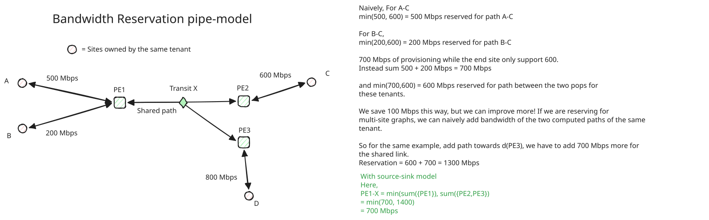
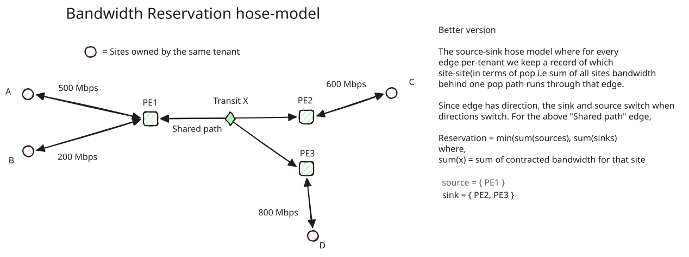
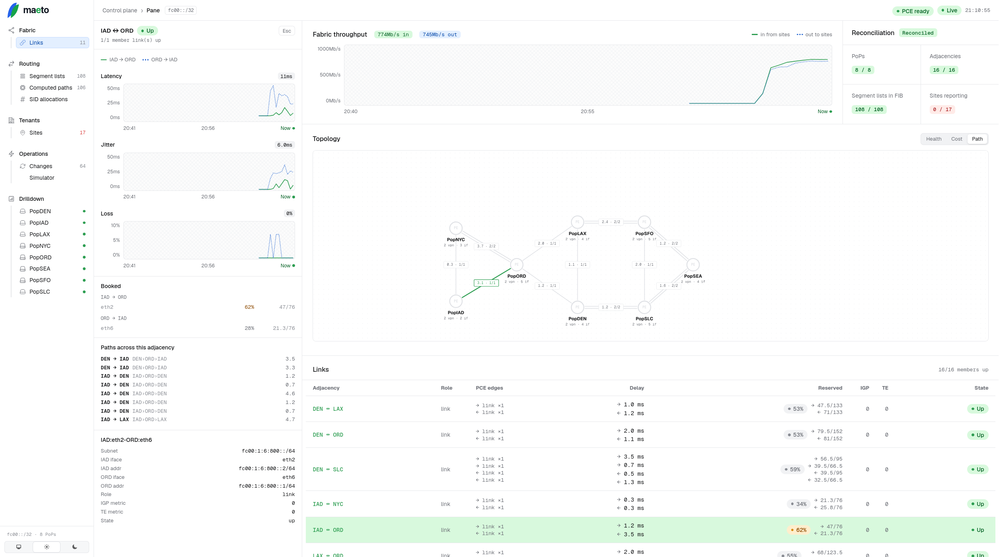
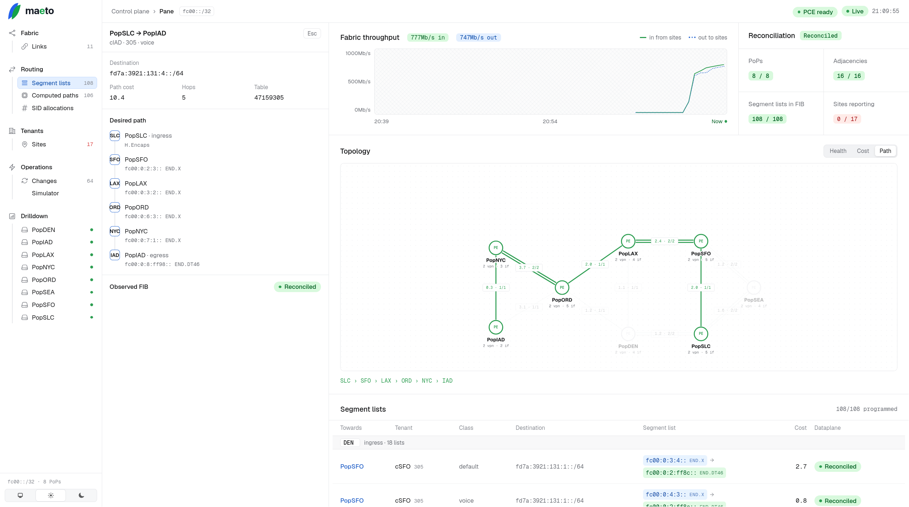
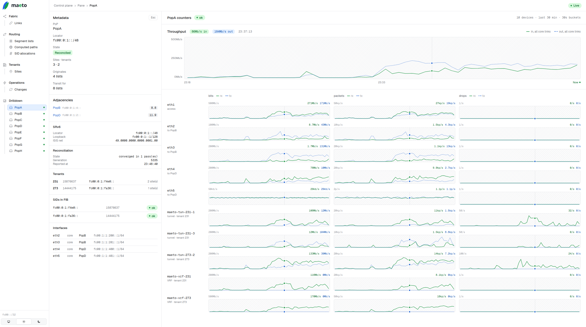
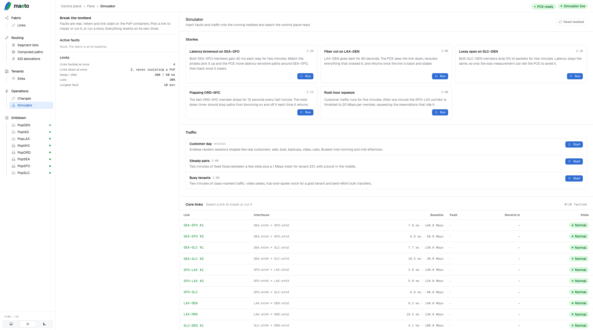

---

Maeto is a SRv6-based SD-WAN platform that provides L3VPN services and routes customer traffic intelligently based on measured latency, jitter, loss and classes. It features:
- a centralized controller (`control-plane`) for computing traffic engineered paths for customers of different tiers with different SLAs and classes, 
- provider daemons (`maeto-agent`) that manage dataplane state for provider-owned routers, and 
- CPE edge daemons (`maeto-portal`) that manage tunnel states towards the provider edge. 

It's a hobby project that runs Docker containers w/ network namespaces to emulate routers through Containerlab.

> [!NOTE]
> The repository on GitHub is a mirror maintained for visibility. Issue tracking and active development are done on [Forgejo](https://git.saphal.me/saphalpdyl/Maeto).

[](https://opensource.org/licenses/Apache-2.0)
[](https://git.saphal.me/saphalpdyl/Maeto/tags)


---

## Contents

- [Architecture](#architecture)
  - [Controller](#controller)
  - [Provider & CPE Agent](#provider--cpe-agent)
- [Features](#features)
  - [Level-triggered reconciliation](#level-triggered-reconciliation)
  - [Bandwidth Reservation](#bandwidth-reservation)
  - [Path Computation](#path-computation)
  - [Active telemetry through STAMP](#active-telemetry-through-stamp)
  - [Realistic traffic with tfsim](#realistic-traffic-with-tfsim)
  - [Breaking the testbed on purpose with maeto-sim](#breaking-the-testbed-on-purpose-with-maeto-sim)
- [Running it](#running-it)
  - [Custom topology](#custom-topology)
- [Layout](#layout)
- [Writeups](#writeups)
- [Status](#status)
- [Screenshots](#screenshots)
- [AI Disclosure](#ai-disclosure)

## Architecture
Distributed architecture of Maeto. The design evolved from shelling out to netlink-based communication. It intends to be compatible with a VPP backend, which is a TO-DO.



### Controller
The controller, or control plane, is the centralized brain of Maeto. It features the Path Computation Element (PCE, [RFC 5440](https://www.rfc-editor.org/info/rfc5440/)), 
tenant management, topology database, telemetry collection, tunnel management, and the cost graph for path computation. 

Although the Path Computation Element (PCE) derives the design heavily from [RFC 5440](https://www.rfc-editor.org/info/rfc5440/), 
it does implement the PCEP (protocol) itself. A few reasons:

- PCEP follows a edge-triggered reconciliation design i.e. it applies deltas/changes as they arrive. While this is simpler to make sense of, it has issues during network parition events where a delta packet being lost completely desyncs agent.
- PCEP support for FRR's `pathd` exists for SR-MPLS, but not for SRv6.

Instead, the controller heavily derives from Kubernetes-style level-triggered reconciliation. Explained [here](#level-triggered-reconciliation).

Currently, the controller supports weighted multi-cost objectives to calculate paths. Currently, latency, jitter, and observed loss are supported as objectives with bandwidth supported as the constraint.
Path computation is yet to mature. It assumes flows to be unsplittable and reroutes are bang-bang instead of drain-and-switch. It does not support constraints such as Shared Risk Link Group(SRLG), affinity, hop counts etc.

#### FRR
Maeto uses FRR's `isisd` with its SRv6 extensions, to distribute reachability info and SR locators throughout the network. 
Initially, I planned to use `pathd` to drive the dataplane installation, but I pivoted given the development was thin for SRv6 (SR-MPLS was supported).

Maeto runs FRR 10.6.0.

### Provider & CPE Agent
The provider agents (`maeto-agent`) and CPE agent (`maeto-portal`) are daemons that run on Linux-based routers in Maeto. 
The daemons accept high-level intent from the controller and reconcile it against their dataplane state. Provider agents 
are equivalent to Path Computation Client (PCC) as per RFC 5440.

Portals are gateways installed in the customer premises edge. They are responsible for creating IPSec tunnels towards the 
Provider Point of Presence (PoP) of choice. They are also responsible for out-of-band device onboarding. The tunnel is driven by 
[strongSwan](https://strongswan.org/) through its VICI socket. 



## Features
These are a collection of the interesting features of Maeto that I gathered while developing the platform.

### Level-triggered reconciliation
Everything that touches state is level-triggered. The reconciler goes through three steps towards reconciliation.
1. **PLAN** This phase collects the desired high-level intent as well as the current dataplane state.
2. **RENDERING** The controller always send dataplane-agnostic high-level intent to the agents. It should never include details that apply to a specific dataplane. This phase is where high-level intent is "rendered" into domain-objects. Similarly, the reconciler renders dataplane state to domain-objects to compare with the desired state.
3. **DIFF** Each domain object (VRF,XFRM,Route,SRRoutes) has a `ID()` method that must be exactly discriminating as the dataplane's key for the same object fetched from it. The reconciler diffs the two rendered states and get a list of objects to remove and add. Currently, the reconciler only support `add`, `remove`, and `remove-and-add` operation. Replace and in-place edit operation require finer comparison through the `CompareTo(...)` method which exists, but is not supported.
4. **APPLY** This phase is where the dataplane state is applied. For Linux, it is done through Netlink.

### Bandwidth Reservation
Maeto supports bandwidth as a constraint i.e. the physical capacity of the link is involved in path computation. 
Naive bandwidth reservation leads to capacity being wasted due to undersubscription. Initially, Maeto implemented the pipe model for bandwidth reservation.



The source-sink hose model does not cause undersubscription since it allocated bandwidth for the minimum bandwidth contracted between the designated sources (one or more customer site) and designated sinks.



### Path Computation
The controller runs constrainted shortes path first algorithm on a pruned topology. A demand matrix is produced from different
customers, their tiers (gold, silver) and classes (voice, streaming, bulk/default). We run greedy CSPF on the graph ordering
customers by their tiers and tie-breaking on their tenant IDs to make the ordering deterministic and prevent path churn. 

Before a path of a certain color ([RFC 9256](https://datatracker.ietf.org/doc/rfc9256/)), or class, is computed for, we calculate the required bandwidth for that class of that tenant and prune
the links which do not meet the minimum bandwidth criteria. The path computation moves on as usual.

The computed path is compared with the previous path with updated costs. Reroute is forbidden with:
- **HYSTERESIS** The new path has to be at least 10% better in terms of cost than the old path. This prevents reroutes on small benefits.
- **HOLD-DOWN TIMERS** A reroute holds that path down for some time, no matter how much better the new path is. The exceptions to this are when a link in the current path goes down, or SLA is breached (future implementation).

PCE runs a weighted cost function when running CSPF where the weights come from class definition. There are four dimensions:
- `LATENCY`
- `JITTER`
- `LOSS`
- `STATIC UTILIZATION`

Collected telemetry from STAMP (see below) is smoothed through an EWMA (Exponentially Weighted Moving Average) and stored as the cost for the given link
for the given objective. Similarly, static bandwidth utilization cost is calculated after bandwidth reservation in the PCE. During path computation the costs in different units and scale are normalized and scaled using reference "considered bad"
values for each objective.

$$C(l,\sigma^2,p,u) = w_l \frac{l}{l_{ref}} + w_{\sigma^2} \frac{\sigma^2}{\sigma^2_{ref}} + w_p \frac{-\ln(1-p)}{-\ln(1-p_{ref})} + w_u \frac{\varphi(u)}{\varphi(u_{ref})} + \varepsilon$$

where,
$$u = \frac{R_e}{B_e \times (1 - h)}, \varphi(f) = \frac{f}{1-f}$$

- $R_e$ is the reserved bandwidth for the link
- $Be$ is the total capacity of the link
- $h$ is the head room fraction to leave for probes and adminstrative traffic
- $u$ is the reserved utilization of the link (not measured)
- $\varepsilon$ is the a tie-break. During path compute, it's the hop count

So with all this mathematical jargon, the total cost of the path, calculated after path computation on pruned graph, comes down to be:
$$C_c(P) = \sum_{e \in P}C_c(e)$$

As you might have noticed, I like to include LaTeX equations wherever I can.  

### Active telemetry through STAMP
Instead of ICMP ping, Maeto agents run unidirectional stateless Simple Two-Way Active Measurement Protocol (STAMP) sessions between two PoPs. [libs/stamp](libs/stamp) implements the [RFC 8762](https://www.rfc-editor.org/info/rfc8762/) 
with Segment Routing Extension [RFC 9503](https://www.rfc-editor.org/info/rfc9503/), and custom Maeto-specific Container TLVs to enable the unidirectional sessions itself. 

The reflector in each PoP collects the telemetry data from its peers, reads the TelemetryKey inside Maeto-Container TLV and forwards to NATS based on the key. 
The controller collects these telemetry, and regroups them based on the source. Then after, jitter and packet loss are derived from the latency and sequence number of the STAMP packet. 


### Realistic traffic with tfsim
A control plane that reroutes on measured cost needs traffic worth reacting to. `clab/tfsim` drives the lab with iperf3 sessions
shaped like real customers. Sessions arrive as a Poisson process whose rate follows a business day, quiet overnight and busiest
mid-morning and mid-afternoon, with a slow log-normal drift on top that produces busy and quiet spells lasting about a minute.

Transfer sizes are Pareto or log-normal and call lengths are log-normal, so a handful of elephant flows carry most of the bytes.
Over a long run the top 10% of sessions carry roughly 70% of them. Each session is one of web, bulk, backup, video streaming,
conference or voice, with its own size, rate, protocol and DSCP marking, which gives the traffic classes something real to steer.
A tenant's largest site acts as its data centre, so content flows out to the branches, backups flow back in and calls run both
ways at different rates. When the flow table is full, new sessions are turned away the way a busy trunk drops a call.

```shell
make tfsim-random # Runs random traffic forever
make tfsim # Runs scene1.yml 
```

### Breaking the testbed on purpose with maeto-sim
The demo is about watching the control plane react, so visitors can break the network themselves from the pane's Simulator page.
`services/maeto-sim` receives their commands over NATS, applies them inside the PoP containers and publishes its state to a KV
bucket that the pane renders.

A visitor can add delay, jitter, loss or a rate cap to a core link in either direction, or take the link down like a fiber cut.
The generator already shapes every link at deploy time with `netem` delay feeding a `tbf` rate limit, and maeto-sim rebuilds that
same chain with the fault added on top, so the base propagation delay and capacity return exactly when the fault clears. The page
also offers one-click stories that each show one behaviour: a latency brownout on SEA–SFO, a fiber cut on LAX–DEN, a lossy span
that only the loss measurement can catch, a flapping link that exercises the hold-down timer, and a rush hour that squeezes a
corridor under customer traffic. Traffic scenarios can be started from the same page.

Because the demo is public, every fault is bounded and temporary. Faults revert on their own after two minutes by default and ten
at most, the size of each impairment is capped, only a few links can be faulted at once and no cut is allowed to isolate a PoP.
One traffic scenario runs at a time and endless ones stop after 15 minutes. maeto-sim also resets the testbed whenever it starts,
so a crash never leaves a fault behind.

## Running it
VM-based local deployment requires [Vagrant](https://developer.hashicorp.com/vagrant) to be installed with the `libvirt` provider. Highly recommend running inside a VM due to strict dependencies and to prevent stale network namespaces/configuration ending up on the host.

```sh
vagrant up # Highly recommended to run in VMs
vagrant ssh

# Run sequentially
make setup   # venvs + git hooks
make pki     # one-time CA, the generator signs PoP and CPE certs off it
make ap      # generate the topology, build the images, deploy the lab
# IMPORTANT: Wait for ap to complete fully

# Run in parallel
make dev     # start the controller
make fe      # maeto-pane
make sim     # maeto-sim, the pane's Simulator page

make clean   # to destroy the lab

# Optional
make dozzle  # for container logs (will later be replaced by Grafana stack)
make nui     # to view NATS state
make ips     # lists ipv6 addresses of interface of each node
```

### Custom topology
Topologies can be defined in `clab/topologies/**` as a `.yml` file. 

```yaml
name: <your-lab-name>

defaults:
  # The generator deterministically generates IPv6 address from these prefixes
  locator_prefix: <node-locator-prefix>
  link_prefix: <interface-prefix>
  edge_prefix: <edge-prefix> # A stand-in for the "internet" in-between customers and the access edge

classes:
  <class-name>: # For eg. voice
    label: 2 # identifier [MUST be unique] RFC 9256 equivalent
    index: 1 # Greater the value, the more priority it has during path computation
    match: { dscp: [...] } # Maeto will match these dscps for this class to <label> when computing paths
    objective: # Weights to count towards the total cost, see [Active telemetry through STAMP]
      latency: x
      jitter: y
      loss: z
  # ... more classes

tiers:
  <tier-name>:
    # index == 0, is always designated as the default/bulk traffic
    index: 2 # Greater the value, the more priority it has during path computation
    # The remaining bandwidth is always assigned to default/bulk
    classes: { <class-name>: <fraction-of-total-bandwidth-assigned> } # For eg. voice: 0.3, streaming: 0.2

tenants:
  - id: xxx # numeric customer identifier
    allocation: <customer-prefix> # Currently only one prefix is supported
    tier: <tier-name>
  # ...

# Topology
pops: # Provider owned edge/transit routers
  - id: <pop-name> # For eg. NYC
    index: 1 # Unique numeric identifier
  # ...

cpes: # This defines customer sites
  - id: cABC # Unique string identifier
    tenant: xxx # id of the tenant this site belongs to
    # We only support a site connecting to one assigned PoP
    # Dynamic access edge selection is future work
    attach: <pop-id>
    prefix: <site-prefix> # Must sit inside the tenant's allocation
    portal_id: <unique-string-id> # Comparable to LDevID [802.1AR: Secure Device Identity]
    reservation_bandwidth: xxx # Total in-out bandwidth contracted for the site in Mbps
    classes: { <class-name>: <Mbps> } # Optional, replaces the tier's split for this site
  # ...

links:
  - a: <pop-id>
    b: <pop-id>
    parallel:
      - bandwidth: <total-capacity-of-link-Mbps>
        delay: xx # Propagation delay in ms
        start_jitter: xx # Jitters propagation delay by start_jitter(ms) during generation
      # ...
  # ...
```

## Layout
```
libs/stamp              RFC 8762 sender and reflector, wire codec, SRv6 TLVs
libs/dataplane          netlink -- vrfs, seg6/seg6local, xfrm, declarative reconciler
libs/probe              probe supervisor, STAMP runners, NATS dispatch
libs/nodesync           intent and snapshot contracts over NATS KV
services/control-plane  topology, intent, cost graph, PCE
services/maeto-agent    runs on each PoP, reconciles intent onto the kernel
services/maeto-portal   runs on each CPE
services/maeto-pane     phoenix liveview ui
clab/generator          topology dsl -> containerlab, frr, addressing, link shaping
clab/tfsim              customer-like traffic: random sessions or fixed scenarios over iperf3
services/maeto-sim      fault injection (netem, link down), stories and tfsim runs for the pane
```

## Writeups
Things I hit along the way, mostly SRv6 and FRR: [blogs.saphal.me/tags/maeto](https://blogs.saphal.me/tags/maeto/)

## Status
Done/In-progress:
- SRv6 dataplane over Netlink. VRFs, xfrm interfaces, seg6/seg6local SIDs and ip rules, reconciled against a desired state
- Eight-pop IS-IS + SRv6 uSID fabric, generated from one topology file along with addressing, FRR config and link shaping
- Intent distributed to agents over NATS KV
- IKEv2/X.509 tunnels out to the CPEs
- Per-link one-way STAMP probing (RFC 8762). The reflector exports its own receive timestamps instead of reflecting
- Latency cost graph fed from the probes. PCE recomputes every tick, 10% gate before it will actually move a path
- maeto-pane: topology, per-link cost, and path changes with the edge whose cost caused them
- Bandwidth-aware hose-modeled path computation
- Passive telemetry collection
- Loss and jitter are NOT seeded values anymore. 

Not yet:
- BGP-LS defined topology instead of statically generated topology
- Link and Node Utilization in Cost  Graph as logical links.
- Flexible Bandwidth Reservation: CIR, PIR and best-effort traffic allocation
- Hybrid: Fast greedy + Slow LP optimization with hold-down timer and partially moving traffic with observations as confirmation
- Cost impact prediction before moving paths
- Flowlet switching for elephant flows w/ eBPF for flow detection and switching itself.

## Screenshots 








---
 by saphalpdyl


## AI Disclosure
Maeto is AI-assisted on peripheral components such as the topology generator, traffic simulator, frontend and DB-related/CRUD
operations in the control-plane. Almost everything in control-plane is written by me excepting for state snapshotting
(for the frontend's use). Likewise, maeto-agent, maeto-portal and libs/ are written by hand.

I use AI assistance where what I'm building isn't focused on the core problem (building an SD-WAN in this case). 
